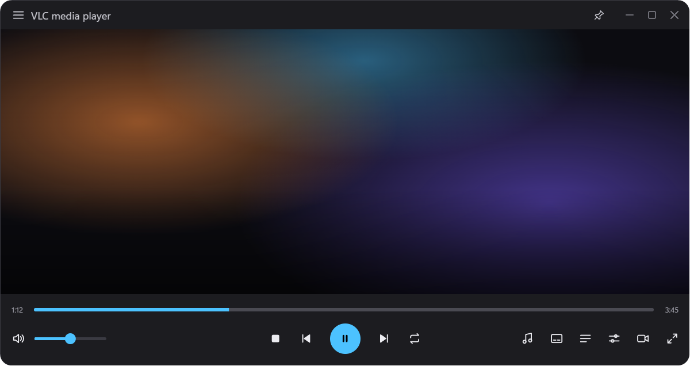

#  HeMi Dark

[](https://github.com/Hemal1k/HeMiDark/releases/latest) [](https://github.com/Hemal1k/HeMiDark/releases) [](LICENSE) 

A dark, minimal skin in the style of **Windows 11** for **VLC 3.0.x** – made for watching video. 9 accent colors, sharp at
every display scale from 100% to 200%.

**[Download](https://github.com/Hemal1k/HeMiDark/releases/latest)** · [Project page](https://hemal1k.github.io/hemidark.html) · [Report a problem](https://github.com/Hemal1k/HeMiDark/issues)



## Download and set up

**[HeMiDark-Skins.zip](https://github.com/Hemal1k/HeMiDark/releases/latest/download/HeMiDark-Skins.zip)** – the skins (`.vlt`) by color and `README.txt`. Needs VLC 3.0.x for Windows (tested with 3.0.24).
Checksum: `SHA256SUMS.txt` in the release – compare it with PowerShell: `Get-FileHash HeMiDark-Skins.zip`.

1. Extract the zip, pick a color folder and the file that matches your display scale (Windows Settings → System → Display →
   Scale): `HeMi-Dark-<color>-100.vlt` … `-200.vlt`.
2. VLC → Tools → Preferences → Interface → *Use custom skin* → choose the `.vlt` → Save → restart VLC.

To go back to the standard look: open the menu (the button at the top left) → Tools → Preferences → *Use native style*.
To hide the VLC icon in the notification area: Tools → Preferences → Show settings: **All** → Interface → Main interfaces → **Skins** → untick *Systray icon* → Save.

What a VLC skin cannot do (limits of VLC's skin engine, not of HeMi Dark): snap the window to the edges of the screen like other windows, hide the controls in a window when the mouse rests (they hide only in full screen), and change the look of the right-click menus.

## What is inside

- **Main window**: title bar with the VLC menu, the file name, always on top, minimize / maximize / close; “Open file” and drag
  and drop when nothing plays; seek bar, times, volume, stop / previous / play-pause / next / repeat, audio track, subtitles,
  video settings, playlist, equalizer, full screen.
- **Playlist**, **equalizer** (on / off, preamp, 10 bands) and the **full-screen controller** in the same style.
- **9 colors** (blue, teal, green, yellow, orange, red, pink, purple, graphite) × **6 scales** (100, 125, 140, 150, 175,
  200%) = 54 skins. VLC skins do not scale with Windows, so every scale is its own skin; 100% fits Full HD.

Subtitles: VLC 3 has no menu of its own for them in skins; the subtitles button opens the main menu (Subtitle → Sub Track),
the key V cycles them, B the audio tracks.

## Building

The skins are not drawn by hand: a small .NET 10 program draws every picture (GDI+, icons from Segoe Fluent Icons, text in
Selawik), writes `theme.xml` and packs one `.vlt` per color and scale. Needs the [.NET 10 SDK](https://dotnet.microsoft.com)
on Windows 11 (or the font [Segoe Fluent Icons](https://aka.ms/SegoeFluentIcons)).

```
dotnet run --project src -c Release
```

writes `build\skins\<color>\HeMi-Dark-<color>-<scale>.vlt`. Switches: `--colors blue,green`, `--scales 100,150`,
`--accent #4CC2FF` or `--accent system` (the Windows accent color, into `build\skins\custom`).

`release.ps1` builds the download (`build\dist\HeMiDark-Skins.zip`). A release
published on GitHub runs the same script in `.github\workflows\release.yml` and gets the zip attached.

To try a skin without touching your VLC settings: set `APPDATA` to an empty folder and start
`vlc.exe --intf=skins --skins2-last=<file.vlt> --no-one-instance --file-logging --logfile=<log>` – problems are in the log
as “skins2 warning” / “skins2 error”.

## Project

| File | Contents |
|---|---|
| `src\Program.cs` | Switches, the colors, the loop over colors and scales. |
| `src\SkinBuild.cs` | One skin: the palette, the pictures of the controls, the four windows, the picture atlas, `theme.xml`, packing. |
| `src\Gfx.cs` | Drawing helpers: rounded shapes, window frame pieces, icons centered by their real pixels, text. |
| `src\Assets` | Selawik (SIL Open Font License, copied into every skin) and `README.txt` for the downloads. |

## License

[MIT](LICENSE). The font Selawik is under the [SIL Open Font License](src/Assets/Fonts/Selawik-LICENSE.txt).
